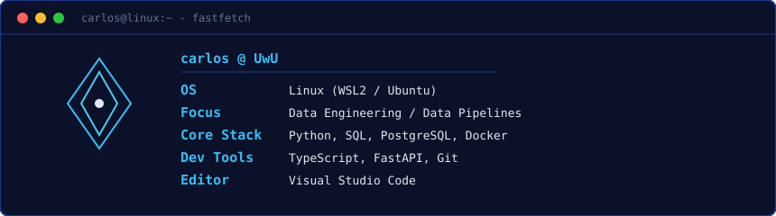

  

## `$ whoami`

  

## `$ cat tech-stack.yaml`

| `carlos@linux:~$ cat tech-stack.yaml` | |
| :--- | :--- |
| `├─ ✦ languages:`      `Python · TypeScript · SQL` | `├─ ◈ databases:`     `PostgreSQL · MySQL` |
| `├─ ◆ tools_infra:`      `Docker · Git · GitHub` | `╰─ ▣ environment:`     `Linux (WSL2) · Ubuntu` |
| `status: learning  ·  environment: development` | |

## `$ ls projects/`

  

  
  

## `$ cat now.yml`

  

## `$ git log --stat`

  

<code>// always processing data. always building.</code>

